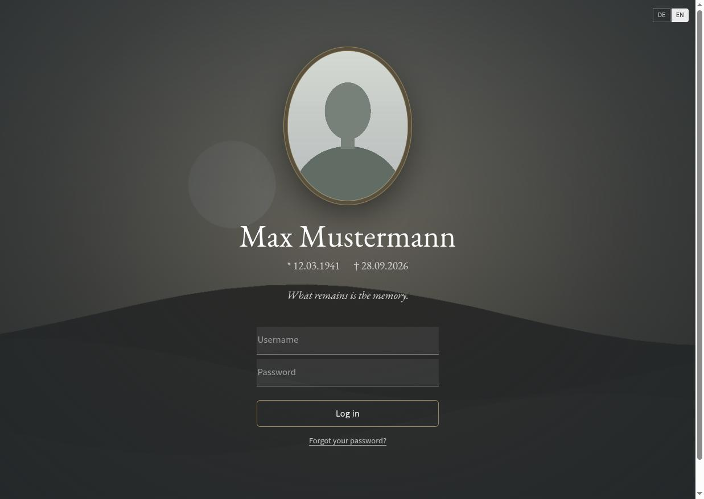
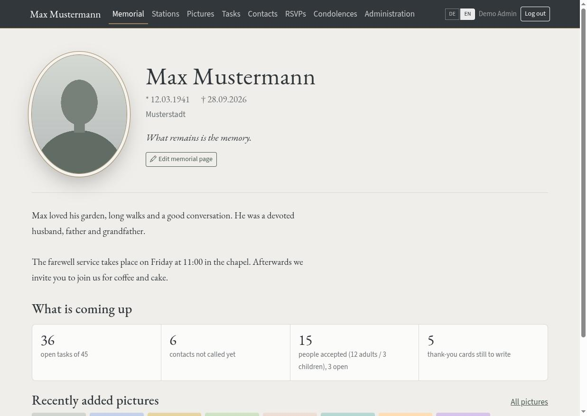
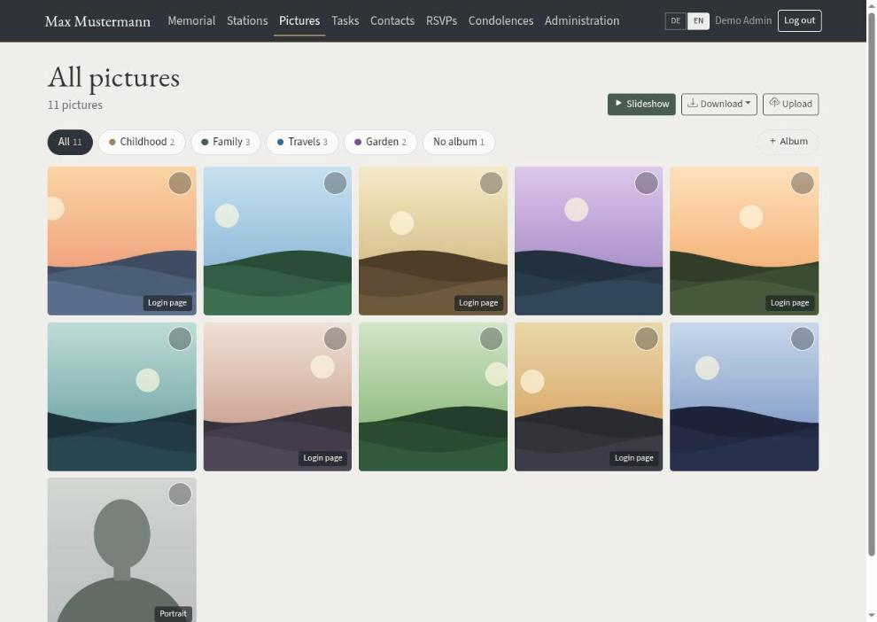
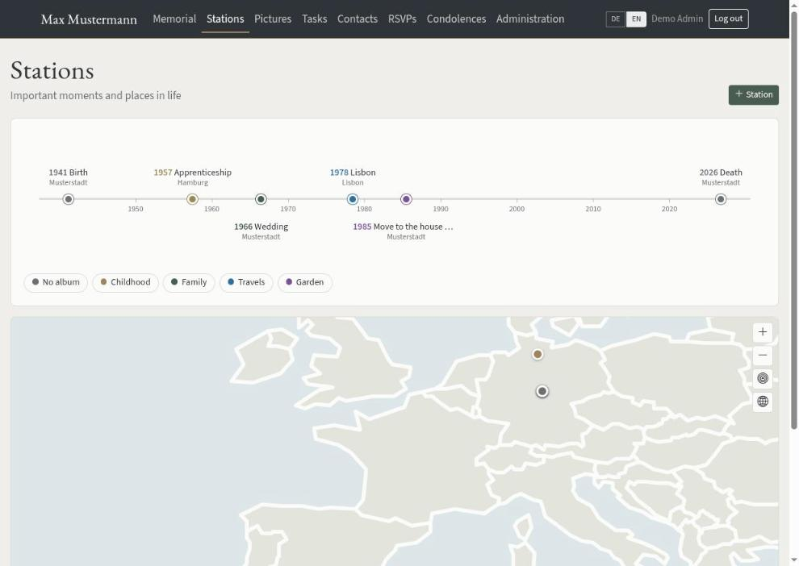
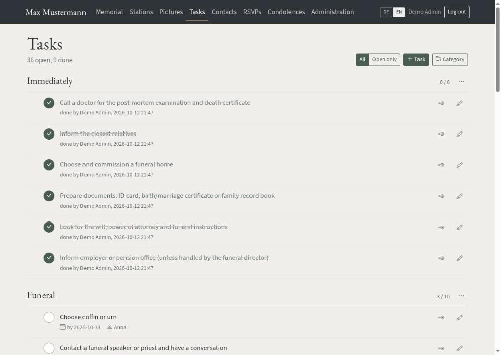
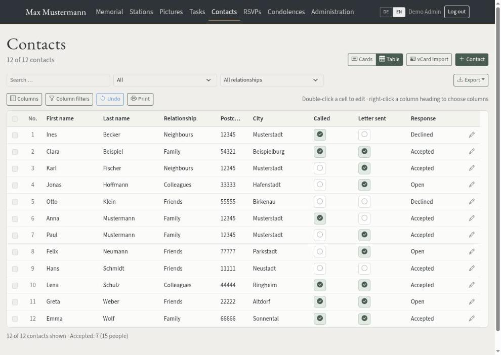
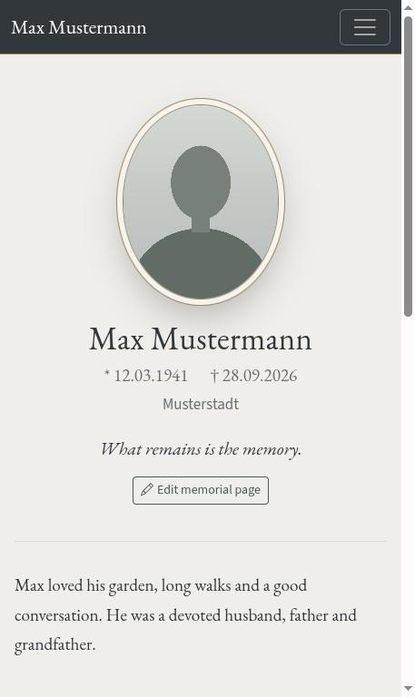

# Gedenkseite – organise a funeral together

[**English**](README.md) · [Deutsch](README.de.md)

A self-hosted web application for families who need to organise a funeral together: a memorial page,
picture gallery with slideshow, task checklists, contacts with call/letter status, RSVPs for the
service, condolences and thank-you cards. PHP 8.2+, **no database** (JSON files), no external
dependencies, no CDNs. The interface is available in English and German.

| | |
|---|---|
|  |  |
|  |  |
|  |  |

The screenshots show made-up sample data. The interface is designed for phones as well:



## Features

- **Memorial page** with portrait, dates, quote and text; login page with a slideshow of selected photos
- **Stations:** timeline and world map, linked to albums
- **Pictures:** albums, multi-file upload, lightbox, slideshow, selection and ZIP download
- **Tasks:** checklists with due dates, assignees and notes; a starter checklist is created during setup
- **Contacts:** addresses, phone numbers, call/letter status, vCard import, XLSX/CSV export, address labels
- **RSVPs** with live totals and **condolences** (card, flowers, wreath, donation, thank-you card)
- **Access control:** users, groups with area and field permissions, shared links (read-only access to chosen areas)
- **Administration:** statistics, activity log, backup, “log in as user”

A complete technical description (architecture, routes, data model) is in **[ECKDATEN.md](ECKDATEN.md)** (German).

## Quick start (try it locally)

```bash
git clone <repository-url> gedenkseite && cd gedenkseite
php -S 127.0.0.1:8080
```

Open `http://127.0.0.1:8080/`. On first visit the setup page appears (create the administrator,
confirm the public address). For real use, see “Installation”.

> PHP's built-in server ignores `.htaccess`, so `data/` and `app/` can be requested directly.
> Use it only locally with test data and never expose it to a network.

## Requirements

- PHP ≥ 8.2 with `gd`, `zip`, `mbstring`, `fileinfo`, `json` (recommended: `exif` for automatic image rotation)
- Apache or nginx with PHP-FPM, HTTPS (for example with Let's Encrypt)
- PHP settings: `upload_max_filesize = 40M`, `post_max_size = 64M`, `memory_limit = 768M`, `max_execution_time = 300`

## Installation

The application knows neither the domain nor the installation path: all links and assets are relative and
`index.php` locates the application directory itself. It runs at the domain root
(`https://example.com/`) or in a subdirectory (`https://example.com/gedenkseite/`) without changes.

### Option 1 – subdirectory of an existing website (Apache)

Everything lives in one folder below the web root; `app/`, `bin/`, `configs/`, `data/` and `docs/` are
blocked by the bundled `.htaccess`. Requires `AllowOverride All`.

```bash
WEB=/var/www/example.com/web/gedenkseite
mkdir -p "$WEB"
rsync -a --exclude .git ./ "$WEB/"      # run inside the project folder
chown -R www-data:www-data "$WEB"
chmod -R o-rwx "$WEB"
```

Open `https://example.com/gedenkseite/`; the setup starts on first visit. Then check that the blocks work.
Both requests must return 403 or 404:

```bash
curl -sI https://example.com/gedenkseite/data/contacts.json | head -1
curl -sI https://example.com/gedenkseite/app/bootstrap.php   | head -1
```

> In this option the data lives inside the web root and is protected only by `.htaccess`. If
> `AllowOverride` is disabled later or the site moves to nginx, `data/` and `configs/config.php` are exposed.
> Switch to option 2 in that case.

### Option 2 – dedicated website, data outside the web root

```bash
cd /var/www/example.com
mkdir -p private/gedenkseite
cp -a /path/to/gedenkseite/{app,bin,configs,data,docs} private/gedenkseite/
cp -a /path/to/gedenkseite/{index.php,.htaccess,assets} web/
chown -R www-data:www-data private/gedenkseite web
chmod -R o-rwx private/gedenkseite
```

`index.php` finds the application automatically in `../private/gedenkseite`.
For nginx, additionally use the directives from `docs/nginx-ispconfig.conf` (written for ISPConfig,
adaptable to other setups).

### Option 3 – custom path

Set `GEDENK_ROOT=/path/to/project` in the PHP-FPM pool (`env[GEDENK_ROOT] = …`) or put a file `app-path.php`
next to `index.php`:

```php
<?php return '/var/www/gedenkseite';
```

### Setup

On first visit the application redirects to the setup page (`index.php?r=setup`). There you create the first
administrator (password ≥ 10 characters, optionally the name of the deceased) and confirm the **public address**
of the application. The address is suggested from the request and stored in `data/settings.json`; it is used for
the links in “forgot password” emails. Without it the application sends no emails (the link must never be built
from the request's Host header). You can change it later with `base_url` in `configs/config.php`, which takes
precedence.

The setup page is **only available while no user exists**; afterwards it returns 404. Open it right after
uploading, before anybody else does.

What the setup does (idempotent, never overwrites existing data):

1. checks the PHP version and extensions
2. creates `configs/config.php` from `config.sample.php` (if missing)
3. creates `data/` with subfolders (the web server user must be able to write there)
4. creates the groups **Family**, **Helpers** and **Inn / caterer**
5. fills the checklist with typical tasks (in the language that is active during setup)
6. creates the first administrator and stores the public address

### PHP settings

For example in the hosting panel under custom `php.ini` settings:

```
upload_max_filesize = 40M
post_max_size = 64M
memory_limit = 768M
max_execution_time = 300
```

## First steps after login

1. **Administration → Groups & permissions:** review the permissions of the default groups
2. **Administration → Users:** create family members
3. **Pictures:** create albums, upload photos; mark suitable pictures with “Edit → Show on login page”
4. **Memorial → Edit memorial page:** name, dates, quote, portrait (an animated GIF stays animated)
5. **Contacts → vCard import:** import the deceased's address book
6. **Administration → Shared links:** for example a link for the venue (read-only access to RSVPs)

> The portrait and pictures marked for the login page are available **without logging in**. Everything else
> requires a login.

## Backup and restore

- **Automatic:** a daily snapshot of all JSON files in `data/backups/YYYY-MM-DD/`; the last `backup_keep_days`
  days are kept (default 14, older snapshots are removed automatically).
- **Manual:** Administration → Backup → data backup (JSON + logs) or full backup (including pictures).
- **Server backup:** backing up `data/` and `configs/config.php` is enough.

Restore:

```bash
# 1. restore the complete data/ folder from the ZIP
unzip Backup_full_….zip -d /tmp/restore
rsync -a /tmp/restore/data/ <installation>/data/

# 2. or restore a single file from a daily snapshot
cp data/backups/2026-09-20/contacts.json data/contacts.json

chown -R www-data:www-data <installation>/data
```

If a JSON file is damaged, the application reports it with the file name; copy the file from the latest snapshot.

## Forgot password

An administrator resets it under Administration → Users. If no administrator can log in:

```bash
php -r 'echo password_hash("NewPassword123", PASSWORD_DEFAULT), "\n";'
# put the hash into data/users.json as "pass_hash" of the user
```

Users can also request a reset link by email (if their account is linked to a contact with an email address and
a public address is configured) or send a request to the administrator.

## Security

- Passwords use `password_hash()` (bcrypt/argon, PHP default) with automatic rehash
- Login lock after 5 failed attempts per IP for 15 minutes, doubling on repeated lockouts
- Session cookie `HttpOnly`, `SameSite=Lax`, `Secure` on HTTPS; timeout after 240 minutes of inactivity
- CSRF token on all write requests
- Content Security Policy without inline scripts, no external resources
- Uploads: MIME check with `finfo`, thumbnails are recomputed, GPS/EXIF data is removed, pixel limit (`image_max_pixels`)
- CSV exports protect cells against formula execution (a leading `=`, `+`, `-` or `@` gets a `'`)
- Reset emails use only the configured public address, never the Host header
- Login lock and reset limits count per `REMOTE_ADDR`. Behind a reverse proxy or CDN all users share one address,
  so five failed attempts would lock everybody out. Run without a proxy or adapt `client_ip()`
- Pictures are served through PHP only, with permission checks
- The log stores shortened IP addresses (configurable) and keeps them for 12 months
- The session cookie is limited to the installation directory; several installations on one domain do not interfere

## Development

```bash
php -S 127.0.0.1:8080
find . -name '*.php' -not -path './data/*' -exec php -l {} \; | grep -v 'No syntax'
php bin/check-lang.php          # verify that German and English language files match
```

To reproduce a subdirectory setup locally, copy the project to `/tmp/wwwroot/gedenkseite/`, run
`php -S 127.0.0.1:8080 -t /tmp/wwwroot` and open `http://127.0.0.1:8080/gedenkseite/`.

Project conventions (no database, no Composer, all texts via language files, every write action with CSRF,
permission check and log entry) are described in [ECKDATEN.md](ECKDATEN.md) (German).

## License

The application is released under the **GNU General Public License v3.0** (see [LICENSE](LICENSE)).
Bootstrap, Bootstrap Icons, Chart.js, the world map and the fonts keep their own licenses, see
[THIRD-PARTY.md](THIRD-PARTY.md).
